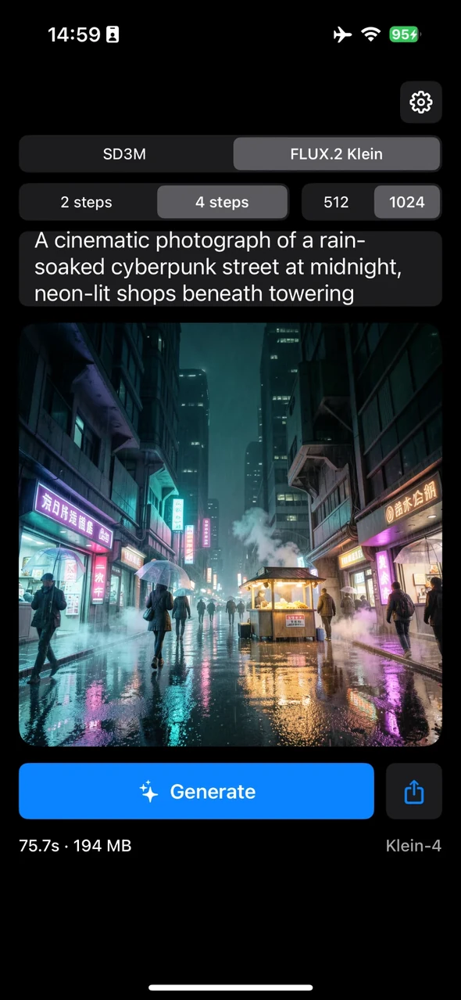
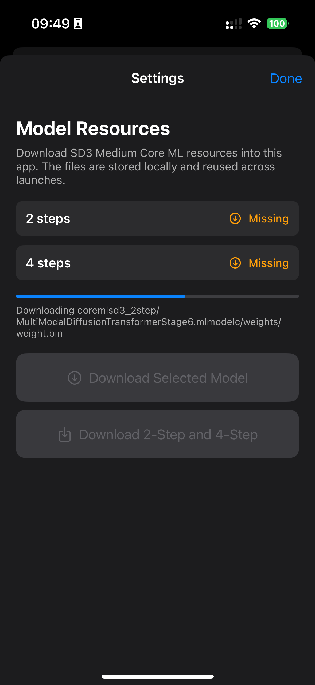
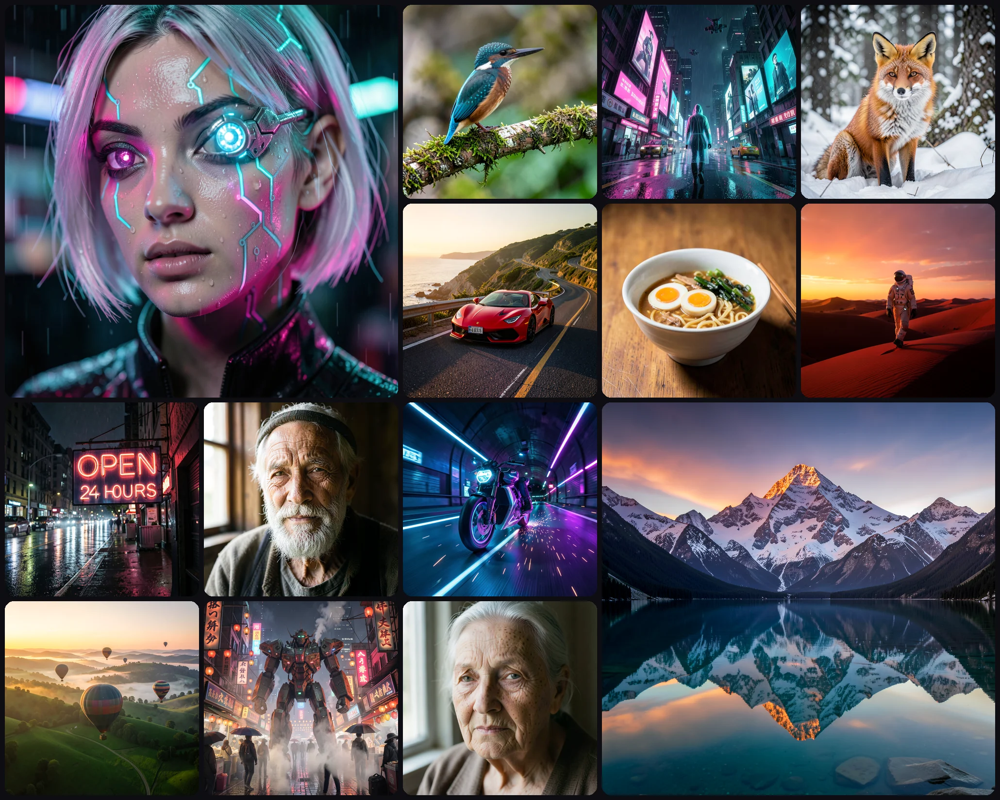

<h1>
  
  MobileDiffuser
</h1>

<br>

**[Project page](https://twwinde.github.io/mobilediffuser-project-page/)** · [Models on Hugging Face](https://huggingface.co/Wenwu2000/MobileDiffuser-SD3-medium) · [Demo video](https://www.youtube.com/shorts/m5wlOkeY5Bw)

MobileDiffuser is an open-source iOS app that runs large diffusion models
entirely on the iPhone with **Core ML on the Apple Neural Engine (ANE)**:

- **FLUX.2 Klein 4B** (4-step distilled), including its Qwen3-4B text encoder
  and VAE — 1024 x 1024 in about 33 s.
- **Stable Diffusion 3 Medium** (2-step and 4-step distilled) — 512 x 512 in
  about 9.4 s and 1024 x 1024 in about 31 s, with
  [ReSeed](https://twwinde.github.io/reseed-project-page/) for seed diversity.

Times are warm runs on an iPhone 15 Pro; the app stays at roughly 60–220 MB of
memory because only one or two small Core ML stages are loaded at a time.

> This is the **`MCL` branch**: the Core ML / ANE app. The `main` branch is a
> separate pure-MLX (GPU) rebuild of the app by Dong Wang; the two branches are
> different codebases.

The repository contains the Swift app, a patched local copy of Apple's
`ml-stable-diffusion` package, conversion scripts, on-device probe tools and
documentation. It does not contain model weights or compiled Core ML bundles.

Mobile diffusion deployment is an active research area, but many published
systems do not release runnable mobile code. This project is open-sourced to
make on-device deployment easier to inspect, reproduce and extend.

## Screenshots

<p>
  
  &nbsp;
  
</p>

Left: FLUX.2 Klein at 1024 x 1024 on an iPhone 15 Pro (this run used the full-resolution
mode). Right: models are downloaded inside the app.

<p>
  
</p>

FLUX.2 Klein, 4 steps, 1024 x 1024, from the same INT8 Core ML stages the app
uses (rendered on a Mac).

[](https://www.youtube.com/shorts/m5wlOkeY5Bw)

## Models and app controls

| Control | Choices |
| --- | --- |
| Model | `SD3M` · `FLUX.2 Klein` |
| Steps | `2 steps` · `4 steps` |
| Resolution | `512` · `1024` |
| ReSeed strength (SD3M, 4 steps) | `off` · `0.5` · `1.0` · `1.5` |
| Speed (FLUX.2 Klein, 1024) | `Fast (512 → 1024)` · `Full 1024` |

- **Generate / Cancel.** A running generation can be cancelled; SD3M stops after
  the current step, FLUX.2 Klein before the next Core ML stage.
- **SD3M 4 steps** is the ReSeed SD3 Medium 4-step DMD student. One set of weights
  serves both modes: `off` is the plain student, the other values add the paper's
  first-interval biases (72,192 parameters) scaled by alpha, without reloading.
- **FLUX.2 Klein 2 steps** runs the same 4-step weights on a 2-step schedule:
  faster, lower quality (text in images becomes unreliable).
- **Fast (512 → 1024)** is mixed-resolution sampling: all but the last step run on
  the 512 stages, the clean-image estimate is upsampled x2 and re-noised, and
  only the last step runs at 1024. It needs both Klein resource folders.
- Guidance is not used (`guidanceScale = 1.0`); both model families are
  guidance-distilled, so every step is a single forward pass.
- Seeds are random; the seed of each run is printed in the debug log.

## Performance

iPhone 15 Pro, iOS 18.5, ANE-first (`cpuAndNeuralEngine`), warm runs.

| Model | Resolution | Text | Denoiser | VAE | Total | App memory |
| --- | ---: | ---: | ---: | ---: | ---: | ---: |
| SD3 Medium 2-step | 512 | — | — | — | ~5.6 s | ~86 MB |
| SD3 Medium 4-step (+ ReSeed) | 512 | 0.7 s | 8.2 s | 0.4 s | ~9.4 s | ~58 MB |
| SD3 Medium 4-step (+ ReSeed) | 1024 | 0.7 s | 25.2 s | 5.4 s | ~31 s | ~146 MB |
| FLUX.2 Klein 4-step, full | 1024 | 2.3 s | 69.9 s | 4.7 s | ~77 s | ~185 MB |
| FLUX.2 Klein 4-step, fast | 1024 | 1.7 s | 26.5 s | 4.7 s | ~33 s | ~220 MB |

- The first generation after install compiles the Core ML stages on the phone,
  once: about 45 s for SD3 Medium at 1024, about 3–4 minutes for FLUX.2 Klein.
- ReSeed adds about 0.2% (18 ms at 512, ~63 ms at 1024, first step only).
- FLUX.2 Klein at 512 and with 2 steps is converted and verified on a Mac but has
  not been timed on the phone.
- These are measurements from local device testing, not a benchmark suite.

## How it works

- **Static-shape Core ML stages on the ANE.** The denoiser is split into small
  compiled models that are loaded, run and released in turn. At 1024 this means
  one transformer block per stage; larger stages stall the on-device ANE compiler.
- **Exact attention in query chunks.** The stock attention op fails ANE
  compilation at 1024 and silently falls back to the CPU (~4 GB, the app is
  killed). Splitting the queries into chunks keeps every op on the ANE with no
  approximation.
- **INT8 linear-symmetric weights**, fp16 compute.
- **Tiled VAE decode** at 1024: 3 x 3 overlapping 512 tiles with feathered blending.
- **FLUX.2 Klein:** Qwen3-4B is cut to the 27 layers Klein reads from and run as
  nine ANE stages; two fp16 overflow traps in the language model are handled in
  the conversion.

Details and measurements, including what did *not* help:

| Document | Contents |
| --- | --- |
| [docs/ANE_1024.md](docs/ANE_1024.md) | SD3 Medium at 1024, attention cost, negative results, mixed-resolution experiment |
| [docs/FLUX2_KLEIN.md](docs/FLUX2_KLEIN.md) | FLUX.2 Klein on the ANE, fast mode, overhead measurements, conversion |
| [docs/RESEED.md](docs/RESEED.md) | ReSeed on device, numerics, measured overhead |
| [docs/ARCHITECTURE.md](docs/ARCHITECTURE.md) | Runtime design of the original 512 app |
| [docs/REPRODUCING_MODELS.md](docs/REPRODUCING_MODELS.md) | Step-by-step SD3 Medium conversion |
| [docs/TECHNICAL_REPORT.md](docs/TECHNICAL_REPORT.md), [docs/IPHONE_OOM_DEBUG.md](docs/IPHONE_OOM_DEBUG.md) | Earlier experiment notes |

## Prebuilt models

Prebuilt Core ML resources and the source distilled checkpoints are on Hugging Face:
[Wenwu2000/MobileDiffuser-SD3-medium](https://huggingface.co/Wenwu2000/MobileDiffuser-SD3-medium).
The app downloads them from its Settings panel into Application Support; no
Python, pip, Git LFS or CLI is needed, and nothing is downloaded at build time.

| Folder | Used for | Size |
| --- | --- | ---: |
| `coremlsd3_2step/` | SD3M, 2 steps, 512 | ~2.7 GB |
| `coremlsd3_reseed/` | SD3M, 4 steps, 512 | ~2.7 GB |
| `coremlsd3_reseed_1024/` | SD3M, 4 steps, 1024 | ~2.7 GB |
| `coreml_flux2_klein_1024/` | FLUX.2 Klein 1024; also holds the text encoder, VAE and tokenizer shared by both Klein resolutions | ~7.5 GB |
| `coreml_flux2_klein_512/` | FLUX.2 Klein 512 denoiser stages (and the fast mode) | ~3.9 GB |

Known gap: the Settings download button fetches one folder at a time, so for
FLUX.2 Klein at 512 or the fast mode, download the 1024 folder as well.

Licenses: Stable Diffusion 3 Medium weights are under the Stability AI Community
License; FLUX.2 Klein 4B and Qwen3-4B are Apache-2.0.

## Quick start

Requirements: a Mac with Xcode 16.2 or newer, an iPhone on iOS 18.2 or newer
(iPhone 15 Pro or newer recommended), and an Apple Developer account for
running on a device.

1. Clone this branch.

   ```bash
   git clone -b MCL https://github.com/TWWinde/MobileDiffuser.git
   cd MobileDiffuser
   ```

2. Open `MobileDiffuser.xcodeproj`, select the `MobileDiffuser` target, choose
   your Team and change the bundle identifier (the project ships with
   `com.example.MobileDiffuser` and an empty team).

3. Build and run on a physical iPhone. The Simulator is useful for UI only; it
   does not reproduce ANE behaviour.

4. In the app, open Settings (gear icon), download the resources for the model
   you selected, then generate.

## Converting models

Conversion needs an Apple Silicon Mac (24 GB memory recommended), Python 3.11
and the source checkpoints.

```bash
python3.11 -m venv .venv && source .venv/bin/activate
pip install -U pip
pip install -e ml-stable-diffusion
pip install -r scripts/requirements.txt
```

- **SD3 Medium, 512 (original layout):** `scripts/convert_sd3_medium_split_coreml.py`
  and `scripts/quantize_mmdit_for_ane.py`; walkthrough in
  [docs/REPRODUCING_MODELS.md](docs/REPRODUCING_MODELS.md).
- **SD3 Medium, one block per stage (1024 and the ReSeed resources):**
  `tools/ane_probe/scripts/convert_sd3m_split_qchunk.py`; see
  [docs/ANE_1024.md](docs/ANE_1024.md) and [docs/RESEED.md](docs/RESEED.md).
- **FLUX.2 Klein:** `convert_flux2_klein_split.py`, `convert_qwen3_split.py` and
  `convert_flux2_vae.py` in `tools/ane_probe/scripts/`; commands in
  [docs/FLUX2_KLEIN.md](docs/FLUX2_KLEIN.md).

## Repository layout

```text
MobileDiffuser/                  SwiftUI app: UI, model selection, resource download
ml-stable-diffusion/             Patched Swift package: SD3 pipeline, ReSeed,
                                 Flux2KleinPipeline, tiled decoder
scripts/                         Original SD3 Medium conversion and quantization scripts
tools/ane_probe/                 iOS probe app (per-op placement, latency, memory on
                                 device) and the conversion / evaluation scripts
tools/sd3_ane_cli/               macOS CLI that runs a resource folder through the
                                 same pipeline as the app (SD3 and --klein)
docs/                            Design notes and measurements
```

## Troubleshooting

**`resources not found` / missing files.** Open Settings and download the selected
model. The app looks in Application Support first, then for a folder of the same
name bundled into the app.

**The first generation takes minutes.** Core ML is compiling the stages for the
ANE; this happens once per install and per resource folder.

**A stage never finishes loading.** A stalled on-device ANE compiler blocks later
loads until the iPhone is rebooted. Reboot, then try again; the same stage
normally compiles afterwards.

**ANE compile or load failure after your own conversion.** Usual causes: a stage
that is too large (use one block per stage at 1024), the stock attention op at
high resolution, a mismatched iOS deployment target, or a folder that mixes files
from different conversions.

**App killed by memory pressure.** Check the `[MEM]` lines in the device log to
see which phase was running. Keeping many stages resident at once is the usual
cause; the pipelines deliberately load stages one at a time.

## Contributing

Contributions are welcome, especially conversion notes for other checkpoints,
ANE compile or load reports with stage sizes and iOS version, and timing or
memory measurements on other iPhone models. Please do not open pull requests
that include model weights or compiled model bundles; share scripts, hashes,
commands and measurements instead.

## License

Code in this repository is intended to be released under the MIT License. Model
weights and converted Core ML assets are subject to their original model
licenses and are not included in this repository.

## Citation

```bibtex
@misc{tang2025mobilediffuser,
  author       = {Wenwu Tang and Dong Wang and Olga Saukh},
  title        = {MobileDiffuser: On-device Stable Diffusion 3 Medium on iPhone with Core ML},
  year         = {2025},
  publisher    = {GitHub},
  journal      = {GitHub repository},
  howpublished = {\url{https://github.com/TWWinde/MobileDiffuser}},
  note         = {Accessed: 2026-06-19}
}
```
